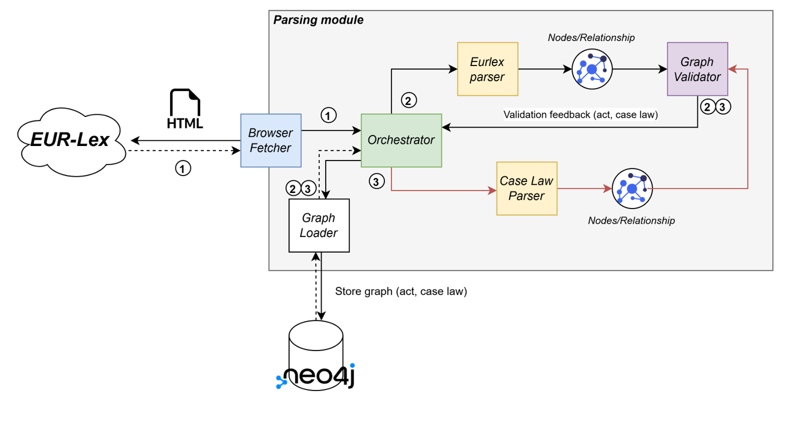
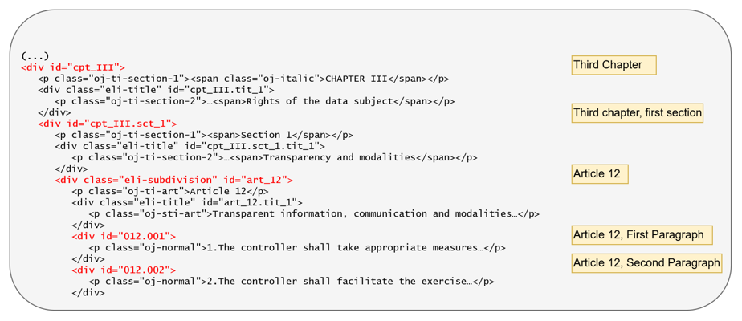
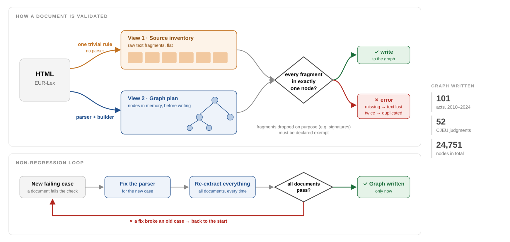
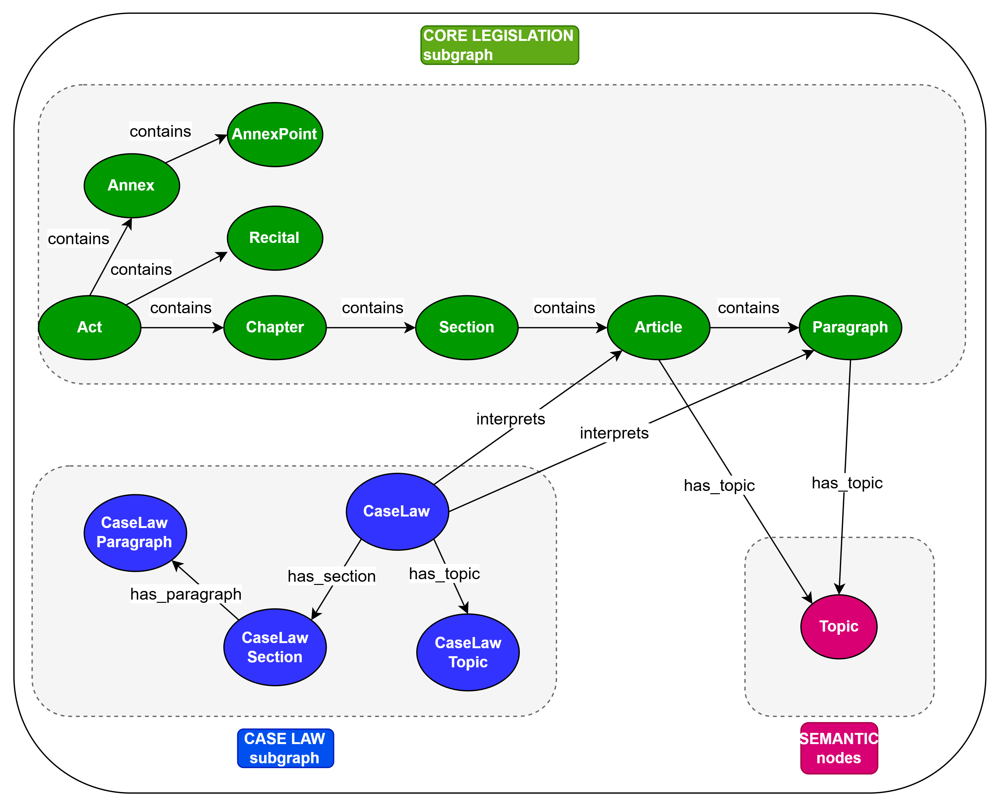
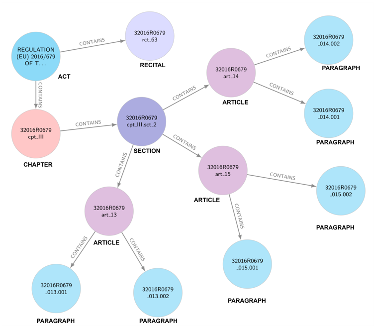
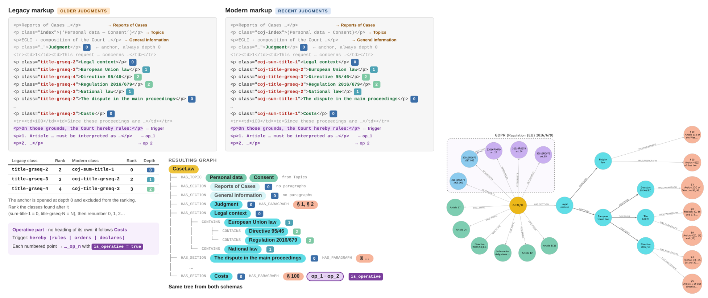
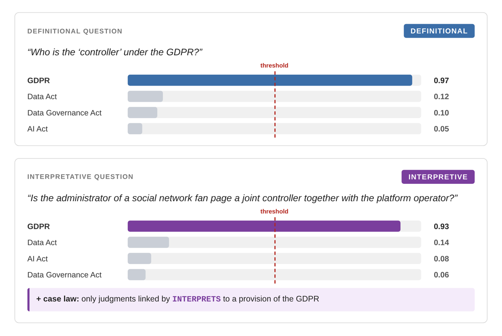
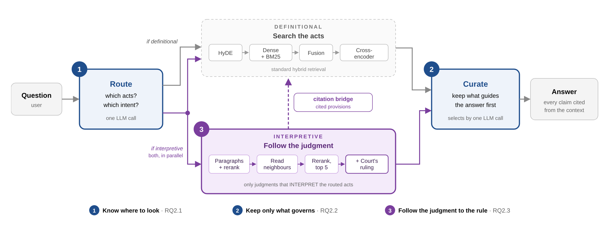
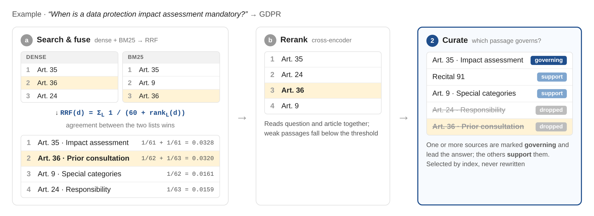
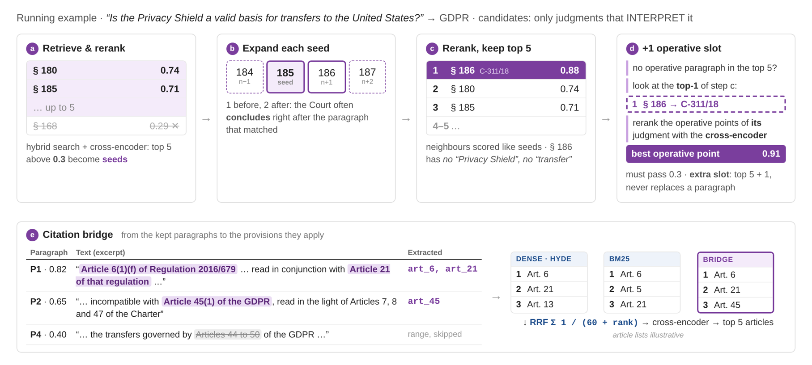

# ThemisRAG

ThemisRAG is a legal question answering system over EU digital regulation. It answers from
several acts and from the
judgments of the Court of Justice of the EU (CJEU) that interpret them, and every claim in
an answer is traceable to the provision or judgment paragraph that supports it. It was
developed as an MSc thesis at the University of Milano-Bicocca.

- [The core idea](#the-core-idea)
- [Extracting the documents](#extracting-the-documents)
- [Modelling acts and judgments](#modelling-acts-and-judgments)
- [The retrieval architecture](#the-retrieval-architecture)
- [How it was evaluated](#how-it-was-evaluated)

## The core idea

Legislators write rules in general terms on purpose, and courts settle what those rules mean
when they apply them to concrete cases. A trustworthy legal assistant therefore has to work
as a lawyer does: find the rule, find the judgments that interpret it, then find the passage
where the Court gives that interpretation.

A traditional RAG system picks the passages that most resemble the question, and this is
where it falls short. The passage of a judgment that answers a question often shares few
words with it. The Court may settle the point in a terse sentence ("It follows that … is
therefore invalid") that names none of the subjects it discussed in the paragraphs before.

**ThemisRAG starts from one assumption: the connection between a provision and the judgment
that clarifies it is a link, not a similarity.** Legal documents already publish much of this
structure, so the system should read it from the sources, keep it in a knowledge graph, and
follow it at query time.

## Extracting the documents

All data comes from [EUR-Lex](https://eur-lex.europa.eu/), the EU's official legal portal.
Every act is identified by its CELEX number. The parser reads the act's published HTML, and
the document-information page of each act lists the concluded judgments that interpret it and
the provision each one concerns. Judgments are then fetched and parsed one at a time, so one
that cannot be fetched is reported without stopping the run.

**Why preserve the structure.** The structure carries legal meaning that flat chunks would
lose:

- a citation needs a locator a lawyer can check, such as an article number or a judgment
  paragraph;
- the operative part of a judgment is binding, while the paragraphs before it are reasoning;
- a holding usually sits right after the argument leading to it, so paragraph order matters.

Chunking by size would discard all of this, then force retrieval to guess it back.

**Why a deterministic parser.** EUR-Lex encodes the hierarchy in its markup, so the structure
can be read and does not have to be inferred:

A language model would add cost and variability to a task that has an exact answer. 
Rules also make the build testable:

- **Conservation:** every piece of source text appears in the graph exactly once.
- **Structure:** edges point at existing nodes, identifiers are unique, and containment forms
  a tree.
- **Determinism:** two runs over the same input produce the same result.
- **Yield:** an act produces at least one article and one paragraph, so an empty build cannot
  pass as a lossless one.

The builder never writes directly to Neo4j. It emits a plan of nodes and edges, the plan is
checked, and only a plan that passes is written, in a single transaction. This also provides
a non-regression cycle: each new document shape that broke the parser led to a fix, and the
whole sample was re-run to confirm that documents already passing still passed.

## Modelling acts and judgments

*The Topic nodes come from an earlier topic-filtering design. Filtering by topic did not
reliably select the right paragraphs, so the default `hybrid` method does not use them.*

### Structure of an act

An act contains chapters, optional sections, articles and paragraphs, plus recitals and
annexes. Not every act is subdivided: short ones list their articles directly, so an article
can sit one, two or three levels below the act. Each identifier combines the CELEX number with
the element's own position, for example `32016R0679art_15`, so article numbers that repeat
across acts do not collide.

### Structure of a judgment, and why the parser is agnostic

A judgment has no fixed template. A diachronic study of 9,434 CJEU judgments (Trklja, *The
textual organisation of CJEU judgments*, International Journal for the Semiotics of Law, 2025)
shows that its sections have changed over time: some were progressively dropped, and others
appear only in some judgments. Studying the
markup across years revealed the same instability at the HTML level, where the class of a
section depends on when the judgment was published:

| Section | C-645/19 (2021) | C-131/12 (2014) |
|---|---|---|
| Legal context | `coj-sum-title-1` | `title-grseq-2` |
| European Union law | `coj-title-grseq-2` | `title-grseq-3` |

A fixed mapping from heading or class to node type would therefore be brittle, so the parser
is agnostic to the structure. For each document, it collects only the heading classes present,
orders them by the rank encoded in their names, and renumbers them from zero. Depth is local to
the document, and no assumption about a class carries over from one judgment to the next. The
result is a generic tree of sections and paragraphs that keeps the original depth, with the
operative part flagged on its paragraphs (`is_operative`).

### Where judgments and acts meet

There are two points of contact, at different granularities:

| | `INTERPRETS` edge | Citation in the text |
|---|---|---|
| **Links** | A whole judgment to an article, paragraph or chapter | A judgment paragraph to an article |
| **Source** | EUR-Lex document-information page | The paragraph's own wording |
| **Resolved** | When the graph is built | At query time |
| **Used to** | Limit the search to judgments on the target acts | Bring the cited articles into the article ranking |

The edge alone is too coarse: C-645/19 is linked to thirteen provisions, and it does not say
which one a given paragraph turns on. Citations in the text provide that detail. Only explicit
citations that name the act are read, and ranges such as "Articles 56 to 58" are skipped
because they delimit a scope and do not identify the rule being applied.

## The retrieval architecture

ThemisRAG follows the graph-based RAG literature, keeping the graph as the backbone of
retrieval, and adopts hybrid retrieval as legal RAG work recommends, because exact terminology
matters in law as much as meaning does. A language model classifies each question, and the
rest of the path depends on the result:

- **Intent:** `DEFINITIONAL` questions can be answered from the legislation, while
  `INTERPRETIVE` questions also need case law.
- **Target acts:** every act gets a relevance score and only those above a threshold are
  searched, because these acts share much of their vocabulary and a single pool would mix them.

### Legislation flow

Every question takes this flow. Its retrieval unit is the whole article.

- **HyDE** bridges the gap between a short question and formal legal text. A language model
  writes hypothetical legal passages, and their averaged embedding drives the dense search.
- **BM25** catches the exact terminology that embeddings can blur.
- **Reciprocal Rank Fusion** merges the lists by position, because cosine and BM25 scores are
  not on a common scale.
- **A cross-encoder** reads each candidate together with the question and rescores it. The top
  articles keep guaranteed slots, while recitals enter only above a score threshold.

### Case law flow

This flow runs only on `INTERPRETIVE` questions, and its retrieval unit is the judgment
paragraph. Candidates are limited through the graph to judgments that interpret the target
acts. Dense and BM25 search are fused and reranked as above, but without HyDE, since its
passages imitate legislation and not the way a judgment reads. Two mechanisms then recover what
search tends to miss:

- **Neighbour expansion:** a holding is often a terse sentence right after a long argument. The
  paragraph before each top hit and the two after it are scored as candidates, and they replace
  a passage only if they outscore it.
- **Operative part guarantee:** the operative part opens with a formal recitation, so it matches
  questions poorly even though it is the binding answer. If none was selected, the best operative
  paragraph of the top judgment is fetched directly and gets one extra slot, provided it clears
  the same threshold.

### How the two flows come together

The flows meet at two points, and neither can displace the other:

1. **The citation bridge joins the flows during ranking.** Articles cited by the selected judgment
   passages become one more ranked list in the legislation fusion, ordered by the score of the
   passage citing them. They receive no privilege, so they must still survive the cross-encoder.
2. **The context joins them at the end.** Judgment passages skip the article fusion and are added
   to the context in their own slots, so articles and judgments never compete.

When case law retrieves nothing, the bridge list is empty and the ranking is the same as in the
legislation flow, so no fallback path is needed.

### From context to answer

Each passage gets a source header naming its locator, for example
`[C-645/19, The first question, para. 71]`. An optional curation step filters passages by index,
so it can remove text but never rewrite it. The generator must rest every claim on the context
and copy each reference verbatim from a header, which makes a plausible but invented article
number structurally difficult to produce.

## How it was evaluated

The thesis evaluates the graph and the answers separately.

### Graph construction

The builder ran on a random sample of 101 acts from 2010 to 2024, drawn with a fixed seed so that
the sample is reproducible and does not resemble the acts used to develop the parser. The source
document itself is the reference, so no manual annotation was needed. All 101 acts were built with
no text lost, no structural violation, and an identical result on a second run. Judgments pass the
same checks when ingested, but they were not evaluated on a random sample.

### Answer quality

ThemisRAG was compared with **LightRAG**, **PathRAG** and **HippoRAG**, each run from its original
implementation. All systems shared the same generator (`gpt-4o-mini`) and the same judge, so that
differences come from what they retrieve and how they present it.

| Dataset | Questions evaluated | Origin |
|---|---|---|
| Legislation (GDPR, Data Governance Act, Data Act) | 52 of 53 | Written with lawyers from a Belgian university |
| Case law (C-311/18, C-245/20, C-645/19) | 38 of 40 | Generated with a language model, imitating the first set |

- **Metrics:** six RAGAS metrics cover three stages: retrieval (context precision and recall),
  generation (faithfulness and answer relevancy), and correctness against the reference (factual
  precision and recall). Precision and recall are kept separate, so each failure can be traced to
  its cause.
- **Statistics:** systems are compared question by question with two-sided Wilcoxon signed-rank
  tests, treating differences below 0.01 as ties.
- **Further analysis:** the thesis also measures how many retrieved sources come from the wrong
  act, and examines individual questions, including those where the architecture fails.

### Main findings

- **Legislation:** ThemisRAG gave the most complete answers (factual recall 0.66, against at most
  0.45), using 3.5 passages on average. Only 3.6% of its retrieved provisions came from an act other
  than the one concerned, against 27-51% for the baselines.
- **GDPR exception:** the advantage on legislation holds on the Data Act and the Data Governance Act
  but largely disappears on the GDPR, where factual recall falls to 0.48, below PathRAG (0.57).
- **Case law:** answers were more precise than those of LightRAG and PathRAG, and comparable to those
  of HippoRAG, where the differences are not significant.

**Limitations:** both datasets are small, the case-law questions were not written by experts, a single
LLM judge computes all the metrics, and the evaluation covers only a narrow part of EU data law.
